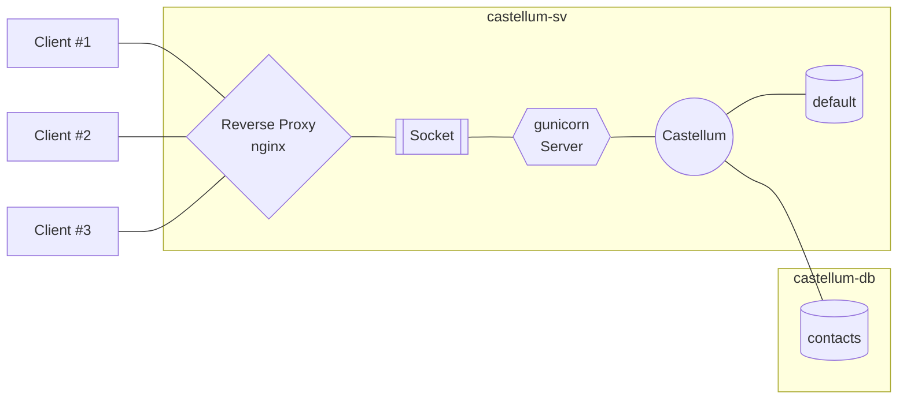

# Example 2: Manual Deployment

This guide walks you through all the steps to set up a production-ready
deployment of Castellum. Familiarity with web servers and databases in
general, and Django and PostgreSQL specifically, is beneficial.

This guide illustrates how to manually install Castellum. If you prefer
a containerized setup, please refer to [Example
1](../example_1/).

## Before You Start

We assume you have root access to two (virtual) machines running a
recent Linux distribution that have internet access and are connected to
the same (private) network:

-   **Host 1**: `castellum-sv`, IP: 192.168.10.1/16
-   **Host 2**: `castellum-db`, IP: 192.168.10.2/16

Depending on your existing infrastructure layout and intended use case,
it might be reasonable to not only logically but physically separate
these hosts (e.g., two discrete boxes in different locations or two VMs
on different root servers).

For simplicity, this guide uses the domain name `castellum.example.com`
and assumes a corresponding valid pem/key pair for SSL certification is
available. Following the recommendation of the main deployment
documentation, we further presume that Castellum is going to be
integrated into an existing LDAP authentication setup:

-   **LDAP Server**: `auth-sv`

## Structure

This deployment uses gunicorn to serve Castellum. An nginx reverse proxy
in front of gunicorn routes (and secures) incoming and outgoing client
traffic to the application server via a Unix socket.

Castellum separates contact data from all other data. We will setup the
`default` database on `castellum-sv`, while the `contacts` database is
located on `castellum-db`.



## Database Setup

Install PostgreSQL on both servers:

```bash
# Red Hat/Fedora/CentOS
dnf install @postgresql

# Debian/Ubuntu
apt install postgresql
```

Next, ensure PostgreSQL is started at boot and launch the corresponding
service:

```bash
systemctl enable postgresql
systemctl start postgresql
```

### On Host `castellum-sv`

Create a database and a corresponding user:

```bash
psql -c "CREATE DATABASE castellum_default;"
psql -c "CREATE USER castellum_default_user WITH ENCRYPTED PASSWORD 'CHANGEME';"
psql -c "GRANT ALL PRIVILEGES ON DATABASE castellum_default TO castellum_default_user;"
```

Modify PostgreSQL's access policy configuration file `pg_hba.conf` to
ensure local connections are allowed to access the `default` database:

```text
# Red Hat/Fedora/CentOS: /var/lib/pgsql/data/pg_hba.conf
# Debian/Ubuntu:         /etc/postgresql/XY/main/pg_hba.conf
#                        (XY denotes the installed PostgreSQL version)
...
# "local" is for Unix domain socket connections only
local   all             all                                     md5
# IPv4 local connections:
host    all             all             127.0.0.1/32            md5
host    all             all             localhost               md5
...
```

Restart the `postgresql` service and test the connection:

```bash
systemctl restart postgresql
psql --dbname=castellum_default --username=castellum_default_user --password
```

### On Host `castellum-db`

Again, create a database and a corresponding user:

```bash
psql -c "CREATE DATABASE castellum_contacts;"
psql -c "CREATE USER castellum_contacts_user WITH ENCRYPTED PASSWORD 'CHANGEME';"
psql -c "GRANT ALL PRIVILEGES ON DATABASE castellum_contacts TO castellum_contacts_user;"
```

Modify PostgreSQL's access policy configuration file `pg_hba.conf` to
permit remote connections only from the `castellum-sv` host:

```text
# Red Hat/Fedora/CentOS: /var/lib/pgsql/data/pg_hba.conf
# Debian/Ubuntu:         /etc/postgresql/XY/main/pg_hba.conf
#                        (XY denotes the installed PostgreSQL version)
...
# IPv4 local connections:
host    all             all             192.168.10.1/16           md5
...
```

Additionally, ensure the database host answers on any active IP assigned
to one of its interfaces:

```text
# Red Hat/Fedora/CentOS: /var/lib/pgsql/data/postgresql.conf
# Debian/Ubuntu:         /etc/postgresql/XY/main/postgresql.conf
#                        (XY denotes the installed PostgreSQL version)
...
# IPv4 local connections:
listen_addresses = '*'
...
```

Restart the `postgresql` service. Log in at `castellum-sv` and test the
connection:

```bash
[root@castellum-sv:~]$ psql --host=castellum-db --dbname=castellum_contacts --username=castellum_contacts_user --password
```

## Python Setup

A Python installation is only required for running the actual Castellum
application. Thus, these steps are only necessary on `castellum-sv`.

First, install required dependencies using the system's package manager:

-   gdal-bin
-   npm
-   python3
-   python3-pip
-   python3-psycopg2
-   python3-gunicorn
-   postgresql-contrib
-   libldap-dev
-   gettext
-   nginx

Clone the Castellum source code from the official repository and check out
a (recent) release:

```bash
cd /opt/
git clone https://git.mpib-berlin.mpg.de/castellum/castellum.git
cd castellum/
git checkout x.y.z # use git tag -l to see a full list of releases
```

Now install Castellum in "editable" mode from its local path and also
install the Javascript dependencies:

```bash
pip3 install -e .
npm install
```

Next, copy the provided configuration file `settings.py` to Castellum's
settings directory:

```bash
cp settings.py /opt/castellum/castellum/settings/deployment.py
```

Generate a secret for the setting `SECRET_KEY`. Similarly, set the
bind password of your LDAP server in the setting
`AUTH_LDAP_BIND_PASSWORD`. You also need to enter the passwords for both
databases. See `castellum/settings/default/` for the full list of
available settings.

When you are done, let Django run some automated checks on your
settings:

```bash
cd /opt/castellum/
export DJANGO_SETTINGS_MODULE="castellum.settings.deployment"
django-admin check --deploy
```

If Django does not complain, run all initial database migrations, load
recommended data and create an admin user::

```bash
django-admin migrateall
django-admin loaddata groups study_types study_groups resources attribute_descriptions
django-admin createsuperuser --username admin
django-admin activate_user admin
django-admin collectstatic
```

Once the initial setup has successfully completed, test Castellum using
Django's built-in development server:

```bash
django-admin runserver --verbosity 3 192.168.10.1:8000
```

Connecting to http://192.168.10.1:8000 in a browser should show
Castellum's login page. Sign in using the admin account created above
and test if the application works correctly (watch the terminal output
for any errors or warnings). If Castellum runs smoothly, press `CTRL+C`
to stop the server and repeat the test with gunicorn.

```bash
gunicorn --bind 192.168.10.1:8000 castellum.wsgi -w 4
```

The above command starts four gunicorn worker processes to serve
Castellum.

**Note** The number of workers to use depends on the hardware
specifications of your machine. The official recommendation is
`(2 * #cores) - 1`, see
[here](https://docs.gunicorn.org/en/stable/design.html#how-many-workers)
for more details.

Check again in a browser if Castellum is accessible (and watch the
terminal for gunicorn errors/warnings). If this final test is
successful, press `CTRL+C` to stop gunicorn and proceed to setting up
systemd.

## systemd service

To make gunicorn start automatically, we will create a system service.

First, install the provided service unit that creates a Unix socket to
handle the communication between gunicorn and ngnix:

```bash
cp castellum.socket /etc/systemd/system/
systemctl daemon-reload
systemctl enable castellum.socket
systemctl start castellum.socket
systemctl status castellum.socket
```

Test if the socket has been created successfully and check its logs:

```bash
file /run/castellum.sock
journalctl -u castellum.socket
# ---> a file access should show up in the log
```

After the socket has been set up correctly, install the provided service
unit for gunicorn and test if the socket connection works:

```bash
cp castellum.service /etc/systemd/system/
systemctl daemon-reload
systemctl enable castellum
systemctl start castellum
systemctl status castellum
curl --unix-socket /run/castellum.sock localhost
journalctl -u castellum
# ---> an HTTP access should show up in the log
```

## nginx

First modify the provided configuration file `castellum.conf`:

-   `server_name`: replace `castellum.example.com` with your actual
    domain name in **both** `server` blocks
-   `ssl_certificate` and `ssl_certificate_key`: replace
    `/etc/castellum/castellum.example.com.pem` and `.key`,
    respectively, with your actual key pair

Next copy the provided nginx configuration file and test it:

```bash
mkdir -p /etc/nginx/sites-available/
mkdir -p /etc/nginx/sites-enabled/
cp castellum.nginx.conf /etc/nginx/sites-available/castellum.conf
ln -s /etc/nginx/sites-available/castellum.conf /etc/nginx/sites-enabled/castellum.conf
nginx -t
```

If nginx does not complain, apply the changes:

```bash
systemctl reload nginx
```

Congratulations, your Castellum instance is now ready to use!

## Wrap Up

As discussed in the main [deployment README](../README.md) Castellum
comes with several management commands to perform regular housekeeping
tasks. An exemplary crontab for running these tasks is provided in the
[Docker-based deployment example](../example_1/crontab). Please also
consult the section discussing [backup strategies](../README.md#backups)
for Castellum's databases in the main guide.

### Updating Castellum

Before performing any updates to your local Castellum instance, it is
strongly recommended to consult the official
[Release Notes](https://git.mpib-berlin.mpg.de/castellum/castellum/-/releases)
to learn about any potential (breaking) changes.

To update your Castellum instance, first stop all Castellum-related
services:

```bash
systemctl stop nginx
systemctl stop castellum.socket
systemctl stop castellum
```

Then navigate to Castellum's locally cloned sources and download (but
not integrate) new data from Castellum's official repository using
``git fetch``:

```bash
cd /opt/castellum
git fetch
git checkout x.y.z
export DJANGO_SETTINGS_MODULE="castellum.settings.development"
cd castellum/
django-admin migrateall
django-admin collectstatic
```

If everything went smoothly, start up the instance again:

```bash
systemctl start nginx
systemctl start castellum.socket
systemctl start castellum
```
