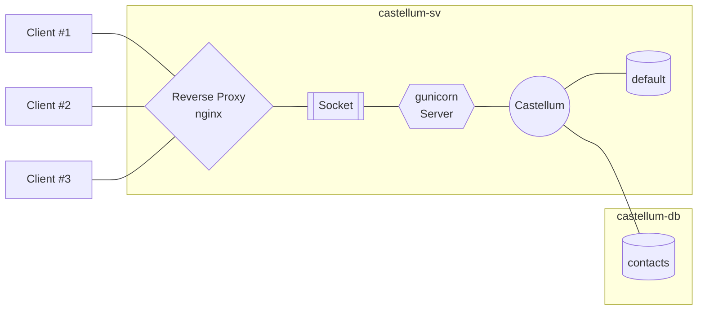

# Production-Ready Deployment

The following guide aims to provide some tips for setting up a production-ready
deployment of Castellum. Just like the rest of the development documentation a familiarity
with web servers and databases in general, and Django and PostgreSQL specifically,
is beneficial. To not needlessly clutter the main text, stubs of most configuration files
are provided alongside this document:

* `customizations.py` Exemplary Django settings file tailored to the specifics detailed in this guide
* `gunicorn-castellum.service` Exemplary systemd unit file for gunicorn hosting Castellum
* `gunicorn-castellum.socket` Exemplary systemd unit file for running a gunicorn Unix socket
* `castellum.conf` Exemplary settings for using nginx as reverse proxy in front of Castellum

## Before You Start

This guide is mainly intended for manual installations of Castellum. If you prefer
a containerized setup, please refer to [example deployment](../example_1/).
We assume you have root access to two (virtual) machines running a recent Linux
distribution that have internet access and are connected to the same (private)
network:

* **Host 1**: `castellum-sv`, IP: 192.168.10.1/16
* **Host 2**: `castellum-db`, IP: 192.168.10.2/16

Depending on your existing infrastructure layout and intended use case, it might
be reasonable to not only logically but physically separate these hosts (e.g.,
two discrete boxes in different locations or two VMs on different root servers).

> FIXME: Any recommended hardware specs?

For simplicity, this guide uses the domain name `castellum.mydomain.org` and implicitly
presumes a corresponding valid pem/key pair for SSL certification is available.
Following the recommendation of the main deployment documentation, we further
presume that Castellum is going to be integrated into an existing LDAP authentication
setup:

* **LDAP Server**: `auth-sv`

Unless explicitly stated otherwise, all command prompts below are intended to
be run as `root`.

## Structure

The layout of the deployment delineated here relies on gunicorn to serve Castellum.
An nginx reverse proxy in front of gunicorn routes (and secures) incoming and
outgoing client traffic to the application server via a Unix socket.



### Logging

Due to the sensitive nature of the data handled by Castellum, an instance should
keep logging to a minimum in production. The provided `customizations.py` settings
file therefore implements a logging configuration that depends on Castellum running
in demo or production mode (`DEBUG = True` or `False`). Specifically, runtime
information is collected as follows:

* `/var/log/castellum_error.log`: internal error messages generated by nginx
* `journalctl -u gunicorn-castellum`: systemd journal of the gunicorn process that serves Castellum
* `/var/log/castellum_monitoring.log`: access records as well as potentially sensitive information (e.g. subject search terms). Only used if `DEBUG = True`

## Preparations

For the sake of simplicity we suppose `SELinux` is deactivated on both hosts.
However, for enhanced security you might want to consider enabling `SELinux` and using
helper tools such as `audit2allow` to generate appropriate policy modules (for
a general introduction to `SELinux` access management, please refer to the [official
Red Hat Product Documentation](https://access.redhat.com/documentation/en-us/red_hat_enterprise_linux/6/html/security-enhanced_linux/sect-security-enhanced_linux-fixing_problems-allowing_access_audit2allow)).

### On Host `castellum-sv`

Install required packages:

```bash
# Red Hat/Fedora/CentOS
dnf install openldap-devel postgresql-contrib nginx
```

```bash
# Debian/Ubuntu
apt install libldap-dev postgresql-contrib nginx
```

### On Both Hosts

Install PostgreSQL:

```bash
# Red Hat/Fedora/CentOS
dnf install @postgresql
```

```bash
# Debian/Ubuntu
apt install postgresql
```

Next, ensure PostgreSQL is started at boot and launch the corresponding service:

```bash
systemctl enable postgresql
systemctl start postgresql
```

## Database Setup

Castellum's `default` database is set up to run on the main host `castellum-sv`,
while the `contacts` database is located on `castellum-db`.

### On Host `castellum-sv`

Start by choosing passwords for both `default` as well as `contacts` databases
and store them in environment variables:

```bash
export DB_DEFAULT_PW="MySuperS3cretPW!"
export DB_CONTACTS_PW="MyReallyS3cretPW!"
```

These variables can then either be stored in a password manager or written to
a file (e.g., `echo "DB_DEFAULT_PW=$DB_DEFAULT_PW" > /etc/castellum/db_default.pw`)

Now create Castellum's `default` database:

```bash
psql -c "CREATE DATABASE castellum_default;"
psql -c "CREATE USER castellum_default_user WITH ENCRYPTED PASSWORD '$DB_DEFAULT_PW';"
psql -c "GRANT ALL PRIVILEGES ON DATABASE castellum_default TO castellum_default_user;"
```

**Note** The database name and user specifications have to coincide with
`DATABASES['default']['NAME']` and `DATABASES['default']['USER']` given in
`customizations.py`!
{: .note}

Modify PostgreSQL's access policy configuration file `pg_hba.conf` to ensure local connections
are allowed to access the `default` database:

```text
# Red Hat/Fedora/CentOS: /var/lib/pgsql/data/pg_hba.conf
# Debian/Ubuntu:         /etc/postgresql/XY/main/pg_hba.conf
#                        (XY denotes the installed PostgreSQL version)
...
# "local" is for Unix domain socket connections only
local   all             all                                     md5
# IPv4 local connections:
host    all             all             127.0.0.1/32            md5
host    all             all             localhost               md5
...
```

Restart the `postgresql` service and test the connection:

```bash
systemctl restart postgresql
psql --dbname=castellum_default --username=castellum_default_user --password
# when prompted, enter the password stored in $DB_DEFAULT_PW
```

### On Host `castellum-db`

Create Castellum's `contacts` database:

```bash
psql -c "CREATE DATABASE castellum_contacts;"
psql -c "CREATE USER castellum_contacts_user WITH ENCRYPTED PASSWORD '$DB_CONTACTS_PW';"
psql -c "GRANT ALL PRIVILEGES ON DATABASE castellum_contacts TO castellum_contacts_user;"
```

**Note** Analogously, the database name and user specifications have to coincide with
`DATABASES['contacts']['NAME']` and `DATABASES['contacts']['USER']` given in
`customizations.py`!
{: .note}

Modify PostgreSQL's access policy configuration file `pg_hba.conf` to permit remote
connections only from the `castellum-sv` host:

```text
# Red Hat/Fedora/CentOS: /var/lib/pgsql/data/pg_hba.conf
# Debian/Ubuntu:         /etc/postgresql/XY/main/pg_hba.conf
#                        (XY denotes the installed PostgreSQL version)
...
# IPv4 local connections:
host    all             all             192.168.10.1/16           md5
...
```

Additionally, ensure the database host answers on any active IP assigned to one of
its interfaces:

```text
# Red Hat/Fedora/CentOS: /var/lib/pgsql/data/postgresql.conf
# Debian/Ubuntu:         /etc/postgresql/XY/main/postgresql.conf
#                        (XY denotes the installed PostgreSQL version)
...
# IPv4 local connections:
listen_addresses = '*'
...
```

Restart the `postgresql` service. Log in at `castellum-sv` and test the connection:

```bash
[root@castellum-sv:~]$ psql --host=castellum-db --dbname=castellum_contacts --username=castellum_contacts_user --password
# when prompted, enter the password store in $DB_CONTACTS_PW
```

## Python Environment Setup

A Python installation is only required for running the actual Castellum application,
thus, these steps are only necessary on `castellum-sv`.

First, install required dependencies using the system's package manager:

* gdal
* krb5
* nodejs
* python3
* python3-pip
* python3-psycopg2
* python3-gunicorn

Clone the Castellum source code from the official repository, check out
a (recent) release and install Castellum's Javascript dependencies:

```bash
cd /opt/
git clone https://git.mpib-berlin.mpg.de/castellum/castellum.git
cd castellum/
git checkout x.y.z # use git tag -l to see a full list of available releases
npm install
pip3 install -e .
```

Now install Castellum in "editable" mode from its local path and copy the provided
configuration file `customizations.py` to its Django settings directory:

```bash
cp customizations.py /opt/castellum/castellum/settings/
pip install -e .
```

Next, generate a secret for Django and save it in an environment variable, e.g.,
`DJANGO_SECRET`. Then, check the Django configuration:

```bash
export DJANGO_SETTINGS_MODULE="castellum.settings.customizations"
cd /opt/castellum/
django-admin check --deploy
```

If Django does not complain, run all initial database migrations, load recommended
data and create an admin user (for more details please see [README](../README.md)):

```bash
django-admin migrateall
django-admin loaddata groups study_types study_groups resources attribute_descriptions
django-admin createsuperuser --username admin
django-admin activate_user admin
django-admin collectstatic
```

Once the initial setup has successfully completed, test Castellum using Django's
built-in development server:

```bash
django-admin runserver --verbosity 3 192.168.10.1:8000
```

Connecting to http://192.168.10.1:8000 in a browser should show Castellum's login
page. Sign in using the admin account created above and test if the application
works correctly (watch the terminal output for any errors or warnings). If Castellum
runs smoothly, press `CTRL+C` to stop the server and repeat the test with gunicorn.

```bash
gunicorn --bind 192.168.10.1:8000 castellum.wsgi -w 4
```

The above command starts four gunicorn worker processes to serve Castellum.

**Note** The number of workers to use depends on the hardware specifications of
your machine. The official recommendation is `(2 * #cores) - 1`, see
[here](https://docs.gunicorn.org/en/stable/design.html#how-many-workers) for more details.
{: .note}

Check again in a browser if Castellum is accessible (and watch the terminal for
gunicorn errors/warnings). If this final test is successful, press `CTRL+C` to stop
gunicorn and proceed to setting up systemd.

## Service Setup

The web server configuration is only required for running the actual Castellum application,
thus, the setup detailed below is only necessary on `castellum-sv`.

### gunicorn

**Note** The gunicorn process has to be run by the same group as nginx.
The default group membership for nginx differs across distributions: in Red Hat/Fedora/CentOS
the group is usually called `nginx`, in Debian/Ubuntu it is `www-data`. Please
check nginx's default group membership setting on your system (found in `/etc/nginx/nginx.conf`)
and modify `Group` in `gunicorn-castellum.service` accordingly.
{: .note}

First, install the provided service unit that creates a Unix socket to handle the communication
between gunicorn and ngnix:

```bash
cp gunicorn-castellum.socket /etc/systemd/system/
systemctl start gunicorn-castellum.socket
systemctl status gunicorn-castellum.socket
systemctl enable gunicorn-castellum.socket
```

Test if the socket has been created successfully and check its logs:

```bash
file /run/gunicorn-castellum.sock
journalctl -u gunicorn-castellum.socket
# ---> a file access should show up in the log
```

After the socket has been set up correctly, install the provided service unit for gunicorn and
test if the socket connection works:

```bash
cp gunicorn-castellum.service /etc/systemd/system/
systemctl start gunicorn-castellum
systemctl status gunicorn-castellum
journalctl -u castellum # check the logs for errors
systemctl enable gunicorn-castellum
curl --unix-socket /run/gunicorn.sock localhost
journalctl -u castellum
# ---> the log should show a "GET / HTTP/1.1" entry
```

If everything looks good, finish the gunicorn setup

```bash
systemctl daemon-reload
systemctl restart gunicorn-castellum
```

### nginx

First modify the provided configuration file `castellum.conf`:

* `server_name`: replace `castellum.mydomain.org` with your actual domain name in **both** `server` blocks
* `ssl_certificate` and `ssl_certificate_key`: replace `/etc/castellum/castellum.mydomain.org.pem` and `.key`,
  respectively, with your actual key pair

Next copy the provided nginx configuration file and test it:

```bash
mkdir -p /etc/nginx/sites-available/
mkdir -p /etc/nginx/sites-enabled/
cp castellum.conf /etc/nginx/sites-available/
ln -s /etc/nginx/sites-available/castellum.conf /etc/nginx/sites-enabled/castellum.conf
nginx -t
```

If nginx does not complain restart its system service and check its logs for errors

```bash
systemctl restart nginx
systemctl status nginx
journalctl -u nginx
```

Congratulations, your Castellum instance is now ready to use.

## Wrap Up

As discussed in the main [deployment README](../README.md) Castellum comes with
several management commands to perform regular housekeeping tasks. An exemplary
crontab for running these tasks is provided in the [Docker-based deployment example](../example_1/crontab).
Please also consult the [section](../README.md#backups) discussing backup strategies for Castellum's
databases in the main guide.
