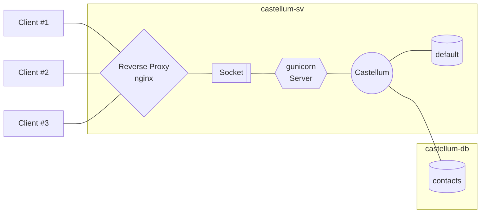

# Production-Ready Deployment

The following guide aims to provide some tips for setting up a production-ready
deployment of Castellum. Just like the rest of the development documentation a familiarity
with web servers and databases in general, and Django and PostgreSQL specifically,
is assumed. To not needlessly clutter the main text, stubs of most configuration files
are provided alongside this document:

* `customizations.py` Exemplary Django settings file tailored to the specifics of the Castellum instance
* `gunicorn-castellum.service` Exemplary systemd unit file for gunicorn hosting Castellum
* `gunicorn-castellum.socket` Exemplary systemd unit file for running a gunicorn Unix socket
* `castellum.conf` Exemplary settings for using nginx as reverse proxy in front of Castellum

## Before You Start

This guide is mainly intended for manual installations of Castellum. If you prefer
a containerized setup, please refer to [example deployment](../example_deployment/).
We assume you have root access to two (virtual) machines running a recent Linux
distribution that have internet access and are connected to the same (private)
network:

* **Host 1**: `castellum-sv`, IP: 192.168.10.1/16
* **Host 2**: `castellum-db`, IP: 192.168.10.2/16

Depending on your existing infrastructure layout and intended use case, it might
be reasonable to not only logically but physically separate these hosts (e.g.,
two discrete boxes in different locations or two VMs on different root servers).

> Any recommended hardware specs?

Following the recommendation of the main deployment documentation, we further
presume that Castellum is going to be integrated into an existing LDAP authentication
setup:

* **LDAP Server**: `auth-sv`

Unless explicitly stated otherwise, all command prompts below are intended to
be run as `root`.

## Structure

The layout of the deployment delineated here relies on gunicorn to serve Castellum.
The gunicorn application server is paired with the asynchronous server gateway
interface (ASGI) implementation uvicorn. An nginx reverse proxy in front of gunicorn
routes (and secures) incoming and outgoing client traffic to the application
server via a Unix socket.



## Preparations

For the sake of simplicity we suppose `SELinux` is deactivated on both hosts.
However, for enhanced security please consider enabling `SELinux` and using
helper tools such as `audit2allow` to generate appropriate policy modules (for
a general introduction to `SELinux` access management, please refer to the [official
Red Hat Product Documentation](https://access.redhat.com/documentation/en-us/red_hat_enterprise_linux/6/html/security-enhanced_linux/sect-security-enhanced_linux-fixing_problems-allowing_access_audit2allow)).

### On Host `castellum-sv`

Install required packages:

```bash
# Red Hat/Fedora/CentOS
dnf install openldap-devel postgresql-contrib nginx
```

```bash
# Debian/Ubuntu
apt install libldap-dev postgresql-contrib nginx
```

Download and install [Miniconda](https://docs.conda.io/en/latest/miniconda.html)
into `/opt/conda`.

### On Both Hosts

Install PostgreSQL:

```bash
# Red Hat/Fedora/CentOS
dnf install @postgresql
```

```bash
# Debian/Ubuntu
apt install postgresql
```

Next, ensure PostgreSQL is started at boot, create new database cluster and start
the corresponding daemon:

```bash
systemctl enable postgresql
systemctl start postgresql
```

```bash
```

## Database Setup

Castellum's `default` database is set up to run on the main host `castellum-sv`,
while the `contacts` database is located on `castellum-db`.

### On Host `castellum-sv`

Create a directory to collect all Castellum-related credentials, choose passwords
for both `default` as well as `contacts` databases and write them to dedicated files:

```bash
mkdir /etc/castellum
"${EDITOR:-emacs}" /etc/castellum/db_default.pw
"${EDITOR:-emacs}" /etc/castellum/db_contacts.pw
```

Ensure the credentials are readable by the `postgres` user

```bash
chown postgres:postgres /etc/castellum/db_*
```

Now create Castellum's `default` database:

```bash
DB_DEFAULT_PW=$(cat /etc/castellum/db_default.pw)
psql -c "CREATE DATABASE castellum_default;"
psql -c "CREATE USER castellum_default_user WITH ENCRYPTED PASSWORD '$DB_DEFAULT_PW';"
psql -c "GRANT ALL PRIVILEGES ON DATABASE castellum_default TO castellum_default_user;"
```

> **Note** The database name and user specifications have to coincide with
`DATABASES['default']['NAME']` and `DATABASES['default']['USER']` given in
`customizations.py`!

Modify PostgreSQL's access policy configuration file `pg_hba.conf` to ensure local connections
are allowed to access the `default` database:

```text
# Red Hat/Fedora/CentOS: /var/lib/pgsql/data/pg_hba.conf
# Debian/Ubuntu:         /etc/postgresql/XY/main/pg_hba.conf
#                        (XY denotes the installed PostgreSQL version)
...
# "local" is for Unix domain socket connections only
local   all             all                                     md5
# IPv4 local connections:
host    all             all             127.0.0.1/32            md5
host    all             all             localhost               md5
...
```

Restart the `postgresql` service and test the connection:

```bash
systemctl restart postgresql
psql --dbname=castellum_default --username=castellum_default_user --password
# when prompted, enter the password found in /etc/castellum/db_default.pw
```

### On Host `castellum-db`

First, fetch credentials from `castellum-sv`:

```bash
mkdir /etc/castellum
scp castellum-sv:/etc/castellum/db_contacts.pw /etc/castellum
```

Now create Castellum's `contacts` database:

```bash
DB_CONTACTS_PW=$(cat /etc/castellum/db_contacts.pw)
psql -c "CREATE DATABASE castellum_contacts;"
psql -c "CREATE USER castellum_contacts_user WITH ENCRYPTED PASSWORD '$DB_CONTACTS_PW';"
psql -c "GRANT ALL PRIVILEGES ON DATABASE castellum_contacts TO castellum_contacts_user;"
```

> **Note** Analogously, the database name and user specifications have to coincide with
`DATABASES['contacts']['NAME']` and `DATABASES['contacts']['USER']` given in
`customizations.py`!

Modify PostgreSQL's access policy configuration file `pg_hba.conf` to permit remote
connections only from the `castellum-sv` host:

```text
# Red Hat/Fedora/CentOS: /var/lib/pgsql/data/pg_hba.conf
# Debian/Ubuntu:         /etc/postgresql/XY/main/pg_hba.conf
#                        (XY denotes the installed PostgreSQL version)
...
# IPv4 local connections:
host    all             all             192.168.10.1/16           md5
...
```

Additionally, ensure the database host answers on any active IP assigned to one of
its interfaces:

```text
# Red Hat/Fedora/CentOS: /var/lib/pgsql/data/postgresql.conf
# Debian/Ubuntu:         /etc/postgresql/XY/main/postgresql.conf
#                        (XY denotes the installed PostgreSQL version)
...
# IPv4 local connections:
listen_addresses = '*'
...
```

Restart the `postgresql` service. Log in at `castellum-sv` and test the connection:

```bash
[root@castellum-sv:~]$ psql --host=castellum-db --dbname=castellum_contacts --username=castellum_contacts_user --password
# when prompted, enter the password found in /etc/castellum/db_contacts.pw
```

## Python Environment Setup

A Python installation is only required for running the actual Castellum application,
thus, these steps are only necessary on `castellum-sv`.

First, set up a dedicated conda environment for Castellum (to avoid any package
conflicts with the operating system's Python installation) and get all required
dependencies (the prefix `$(castellum):` below denotes the activated conda environment):

```bash
source /opt/conda/etc/profile.d/conda.sh
conda create -n castellum python=3.8
conda activate castellum
$(castellum): conda install gdal krb5 python-dateutil requests psycopg2 jsonschema nodejs
$(castellum): pip install uvicorn gunicorn
```